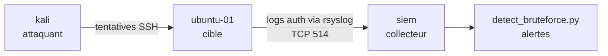

# 🛡️ mini-SIEM : détection d'attaques par force brute SSH

Projet personnel de cybersécurité : un **mini-SIEM** écrit en Python, qui analyse des logs SSH centralisés et détecte les attaques par force brute. Il tourne dans un **home lab** monté de zéro, où je joue à la fois l'attaquant (Kali Linux) et le défenseur (collecte et analyse des logs).

> Objectif : comprendre de l'intérieur comment fonctionne un SIEM : collecte, parsing, règles de détection, gestion des faux positifs.

---

## 🏗️ Architecture du lab

Le lab tourne sur un mini PC (Lenovo ThinkCentre M920q) sous **Proxmox VE**, avec trois machines virtuelles :

| VM | Rôle | Système |
|---|---|---|
| `kali` | Attaquant : génère les attaques | Kali Linux 2026.3 |
| `ubuntu-01` | Cible : serveur SSH durci | Ubuntu Server 26.04 LTS |
| `siem` | Collecteur : reçoit et analyse les logs | Ubuntu Server 26.04 LTS |



**Accès distant** : Tailscale, avec Proxmox en *subnet router*. Aucun port n'est ouvert sur la box Internet.

### Durcissement de la cible
- Authentification SSH **par clé uniquement** (`PasswordAuthentication no`)
- Connexion root interdite (`PermitRootLogin no`)
- Pare-feu `ufw` : seul SSH est exposé (vérifié par un scan `nmap` depuis Kali)

### Collecte des logs
`ubuntu-01` transfère ses logs d'authentification (`auth,authpriv.*`) vers `siem` avec **rsyslog** en TCP. La file d'attente garde les logs si le collecteur est indisponible. Côté `siem`, les logs sont rangés par machine et par programme :

```
/var/log/remote/<machine>/<programme>.log
```

---

## ⚙️ Fonctionnement du détecteur

`detect_bruteforce.py` procède en trois étapes :

1. **Parsing** : chaque ligne est comparée à une liste de motifs d'échec (`MOTIFS_ECHEC`). Si elle correspond, on extrait l'**IP source**, l'**utilisateur visé** et l'**horodatage** (ISO 8601).
2. **Agrégation** : pour chaque IP, on stocke le nombre d'échecs, les utilisateurs tentés et les heures d'échec.
3. **Détection** : pour chaque IP, on cherche le plus grand nombre d'échecs survenus dans une **fenêtre glissante** de `FENETRE` secondes. S'il atteint `SEUIL`, une alerte est levée.

### Événements détectés

| Événement OpenSSH | Exemple |
|---|---|
| Mot de passe refusé | `Failed password for remikaseya from 192.168.1.14 port 49376 ssh2` |
| Utilisateur inexistant | `Invalid user admin from 192.168.1.29 port 36864` |
| Utilisateur **existant** non authentifié | `Connection closed by authenticating user root 192.168.1.29 port 51234 [preauth]` |

Le troisième cas est un **angle mort** découvert pendant les tests. Comme les mots de passe sont désactivés, une attaque sur un compte qui existe (`root`) ne produit ni `Invalid user` ni `Failed password` : elle passait inaperçue. C'est pourtant l'attaque la plus dangereuse.

### Pourquoi une fenêtre de temps ?

| Situation | Sans fenêtre | Avec fenêtre (3 échecs / 60 s) |
|---|---|---|
| 4 échecs en 7 secondes | ⚠️ Alerte | ⚠️ Alerte : **vrai positif** |
| 3 échecs étalés sur une journée | ⚠️ Alerte | ℹ️ Info : **faux positif évité** |

Un robot enchaîne les tentatives en quelques secondes ; un humain qui se trompe de mot de passe, non.

### Correspondance MITRE ATT&CK

| Technique | Description |
|---|---|
| [T1110 – Brute Force](https://attack.mitre.org/techniques/T1110/) | Tentatives répétées d'authentification |
| [T1110.001 – Password Guessing](https://attack.mitre.org/techniques/T1110/001/) | Essais de mots de passe sur des comptes |
| [T1110.003 – Password Spraying](https://attack.mitre.org/techniques/T1110/003/) | Un même essai sur plusieurs comptes (`admin`, `root`, `test`…) |

---

## 🚀 Utilisation

### Configuration
En haut du script :

```python
SEUIL = 3       # nombre d'échecs déclenchant une alerte
FENETRE = 60    # durée de la fenêtre, en secondes
```

Le fichier à analyser est passé **en argument**. Sans argument, le script lit les logs de `ubuntu-01` sur `siem` (`/var/log/remote/ubuntu-01/sshd-session.log`).

### Lancement sur `siem` (vrais logs)
```bash
sudo python3 detect_bruteforce.py
```
`sudo` est nécessaire pour lire les logs.

### Test local avec le fichier d'exemple
```bash
python3 detect_bruteforce.py sshd-session.log
```

### Exemple de sortie
```
ℹ️  192.168.1.14 - 1 échec(s) - utilisateurs : remikaseya
⚠️  ALERTE : 192.168.1.20 a échoué 4 fois en moins de 60 secondes (brute force probable) - utilisateurs : admin, root, test, oracle
ℹ️  192.168.1.30 - 3 échec(s) - utilisateurs : remikaseya, remikaseya, remikaseya
⚠️  ALERTE : 192.168.1.40 a échoué 3 fois en moins de 60 secondes (brute force probable) - utilisateurs : root, root, root
```

### Reproduire une attaque (depuis Kali)
```bash
for u in admin root test oracle guest; do ssh -o BatchMode=yes $u@<IP_CIBLE>; done
```
⚠️ À utiliser uniquement sur ses propres machines.

---

## 🚧 Limites connues

- **Double comptage possible** : si l'authentification par mot de passe est activée, OpenSSH peut écrire `Invalid user` **et** `Failed password` pour une même tentative.
- **Analyse ponctuelle** : le script lit le fichier une fois ; il ne surveille pas encore en temps réel.
- **Une seule source** : un seul fichier de log est analysé à la fois (choisi en argument).
- **Liste des utilisateurs** : elle couvre tout l'historique de l'IP, pas uniquement la rafale qui a déclenché l'alerte.
- **Performance** : l'algorithme de fenêtre est en O(n²). C'est suffisant pour un lab, mais améliorable (liste triée + `break`, ou deux pointeurs).
- **Format de log** : le parseur attend des dates ISO 8601, telles qu'écrites par rsyslog.

---

## 🗺️ Feuille de route

- [x] Lab Proxmox : cible, attaquant et collecteur
- [x] Centralisation des logs avec rsyslog
- [x] Détection par seuil et fenêtre de temps
- [x] Détection des attaques sur des comptes existants
- [ ] Détection d'une **intrusion réussie** (échecs puis `Accepted`)
- [ ] Surveillance **en temps réel** + service `systemd`
- [ ] Nouvelles règles : échecs `sudo`, création d'utilisateur, scan de ports (logs `ufw`)
- [ ] Stockage des alertes (JSON / SQLite) et notifications
- [ ] Tableau de bord

---

## 🧠 Compétences mobilisées

- **Systèmes & réseau** : Proxmox VE, Linux (Ubuntu, Kali), SSH, adressage IP, DHCP, VPN (Tailscale)
- **Sécurité** : durcissement SSH, pare-feu `ufw`, reconnaissance `nmap`, centralisation de logs, ingénierie de détection, faux positifs, MITRE ATT&CK
- **Développement** : Python (expressions régulières, `datetime`, structures de données), Git / GitHub
