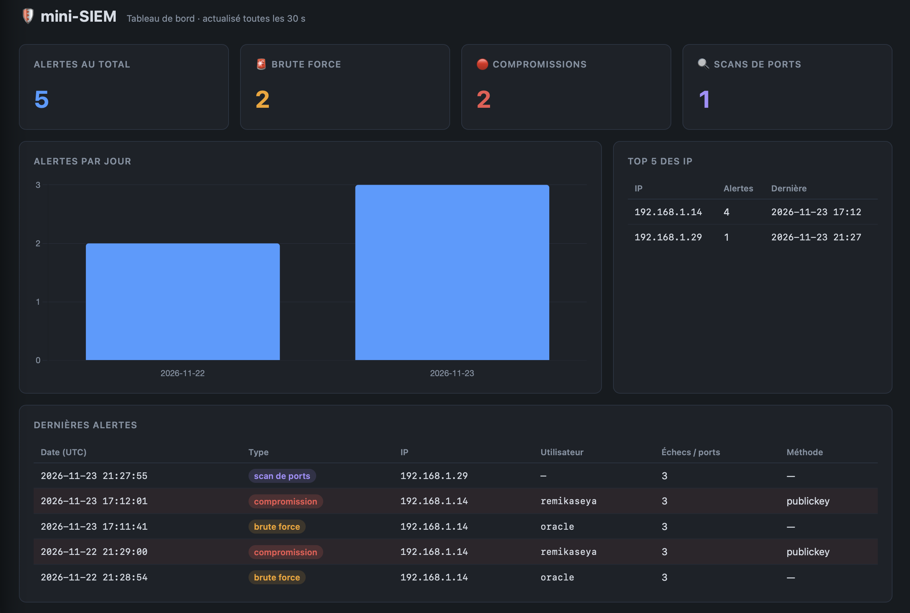
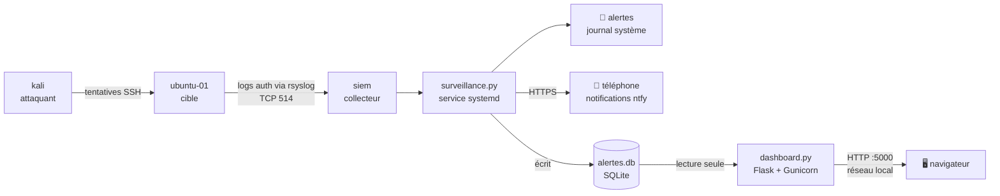

# 🛡️ mini-SIEM : détection d'attaques par force brute SSH

Projet personnel de cybersécurité : un **mini-SIEM** écrit en Python, qui analyse **en temps réel** des logs SSH centralisés et détecte les attaques par force brute, les **compromissions** (brute force suivi d'une connexion réussie) et les **scans de ports**. Les alertes sont envoyées sur téléphone, stockées dans SQLite et consultables dans un **tableau de bord web**.

 Il tourne dans un **home lab** monté de zéro, où je joue à la fois l'attaquant (Kali Linux) et le défenseur (collecte et analyse des logs).

> Objectif : comprendre de l'intérieur comment fonctionne un SIEM : collecte, parsing, règles de détection, gestion des faux positifs.

---

## 🏗️ Architecture du lab

Le lab tourne sur un mini PC (Lenovo ThinkCentre M920q) sous **Proxmox VE**, avec trois machines virtuelles :

| VM | Rôle | Système |
|---|---|---|
| `kali` | Attaquant : génère les attaques | Kali Linux 2026.3 |
| `ubuntu-01` | Cible : serveur SSH durci | Ubuntu Server 26.04 LTS |
| `siem` | Collecteur : reçoit et analyse les logs | Ubuntu Server 26.04 LTS |



**Accès distant** : Tailscale, avec Proxmox en *subnet router*. Aucun port n'est ouvert sur la box Internet.

### Durcissement de la cible
- Authentification SSH **par clé uniquement** (`PasswordAuthentication no`)
- Connexion root interdite (`PermitRootLogin no`)
- Pare-feu `ufw` : seul SSH est exposé (vérifié par un scan `nmap` depuis Kali)

### Collecte des logs
`ubuntu-01` transfère deux sources de logs vers `siem` avec **rsyslog** en TCP :

- les logs d'**authentification** (`auth,authpriv.*`) : SSH, `sudo`… ;
- les logs du **noyau** (`kern.*`), dont les paquets bloqués par le pare-feu (`ufw logging low`).

 La file d'attente garde les logs si le collecteur est indisponible. Côté `siem`, les logs sont rangés par machine et par programme :

```
/var/log/remote/<machine>/<programme>.log
```

Les fichiers sont créés en `0640` et les dossiers en `0750`, avec le groupe `adm` : seuls rsyslog et les membres de `adm` peuvent lire les logs.

---

## 📁 Contenu du dépôt

| Fichier | Rôle |
|---|---|
| `detect_bruteforce.py` | Parseur, règle de détection et **analyse ponctuelle** d'un fichier de logs |
| `surveillance.py` | **Surveillance en temps réel** : suit le fichier, alerte au fil de l'eau (brute force 🚨 et compromission 🔴) et envoie des notifications |
| `mini-siem.service` | Unité `systemd` pour faire tourner la surveillance en permanence sur `siem` (sujet ntfy à personnaliser) |
| `dashboard.py` | **Tableau de bord web** (Flask) : compteurs, top des IP, dernières alertes, graphique |
| `templates/dashboard.html` | Page HTML du tableau de bord (graphique Chart.js) |
| `mini-siem-dashboard.service` | Unité `systemd` du tableau de bord (Gunicorn, compte dédié en lecture seule) |
| `outils/generer_alertes_test.py` | Génère une base d'alertes **fictives** pour développer le tableau de bord en local |
| `docs/dashboard.png` | Capture d'écran du tableau de bord |
| `sshd-session.log` | Logs d'exemple pour tester en local |

---

## ⚙️ Fonctionnement du détecteur

`detect_bruteforce.py` procède en trois étapes :

1. **Parsing** : chaque ligne est comparée à une liste de motifs d'échec (`MOTIFS_ECHEC`) et à un motif de connexion réussie (`MOTIF_SUCCES`). Si elle correspond, on extrait l'**IP source**, l'**utilisateur visé** et l'**horodatage** (ISO 8601).
2. **Agrégation** : pour chaque IP, on stocke le nombre d'échecs, les utilisateurs tentés et les heures d'échec.
3. **Détection** : pour chaque IP, on cherche le plus grand nombre d'échecs survenus dans une **fenêtre glissante** de `FENETRE` secondes. S'il atteint `SEUIL`, une alerte est levée.

### Événements détectés

| Événement | Exemple |
|---|---|
| Mot de passe refusé | `Failed password for remikaseya from 192.168.1.14 port 49376 ssh2` |
| Utilisateur inexistant | `Invalid user admin from 192.168.1.29 port 36864` |
| Utilisateur **existant** non authentifié | `Connection closed by authenticating user root 192.168.1.29 port 51234 [preauth]` |
| Connexion **réussie** | `Accepted publickey for remikaseya from 192.168.1.14 port 49400 ssh2` |
| Paquet **bloqué par le pare-feu** | `kernel: [UFW BLOCK] IN=ens18 ... SRC=192.168.1.29 DST=192.168.1.28 ... PROTO=TCP SPT=64354 DPT=23 ...` |

Le troisième cas est un **angle mort** découvert pendant les tests. Comme les mots de passe sont désactivés, une attaque sur un compte qui existe (`root`) ne produit ni `Invalid user` ni `Failed password` : elle passait inaperçue. C'est pourtant l'attaque la plus dangereuse.

### Pourquoi une fenêtre de temps ?

| Situation | Sans fenêtre | Avec fenêtre (3 échecs / 60 s) |
|---|---|---|
| 4 échecs en 7 secondes | ⚠️ Alerte | ⚠️ Alerte : **vrai positif** |
| 3 échecs étalés sur une journée | ⚠️ Alerte | ℹ️ Info : **faux positif évité** |

Un robot enchaîne les tentatives en quelques secondes ; un humain qui se trompe de mot de passe, non.

### Surveillance en temps réel

`surveillance.py` fonctionne comme un `tail -f` :

1. Il se place à la **fin** du fichier et attend les nouvelles lignes (générateur Python avec `yield`).
2. À chaque échec, il ajoute l'heure à la liste de l'IP, puis **oublie les échecs sortis de la fenêtre** (fenêtre glissante). La longueur de la liste donne directement le nombre d'échecs récents.
3. Si ce nombre atteint `SEUIL`, il lève une alerte, **une seule fois par fenêtre et par IP** : pendant une attaque de 100 tentatives, on reçoit une alerte par minute, pas 98.

```
🚨 [2026-11-22 17:25:12] ALERTE BRUTE FORCE : 192.168.1.29 a échoué 3 fois en moins de 60 s (dernier utilisateur visé : test)
```

Les heures sont en **UTC**, comme dans les logs : toutes les machines du lab partagent le même fuseau, ce qui facilite la corrélation des événements.

### Règle critique : compromission après brute force

Un brute force qui échoue est une tentative. Un brute force **suivi d'une connexion réussie** depuis la même IP signifie probablement que l'attaquant a trouvé un accès valide et **est entré** dans la machine.

À chaque connexion réussie (`Accepted`), `surveillance.py` regarde les échecs récents de l'IP. S'il y en a au moins `SEUIL` dans les `FENETRE` dernières secondes, il lève une **alerte critique** :

```
🔴 ALERTE CRITIQUE: 192.168.1.14 a réussi par bruteforce (publickey) à se connecter à remikaseya à 2026-11-22 17:58:42 après 3 échecs!
```

La **méthode** d'authentification fait partie de l'alerte, car elle oriente l'enquête : `password` après un brute force indique un mot de passe deviné ; `publickey` est plus inhabituel et peut signaler une clé volée.

La règle utilise le même seuil que le brute force : une simple faute de frappe avant une connexion légitime ne déclenche pas d'alerte critique.

### Détection de scan de ports

Avant d'attaquer, un attaquant cherche les services ouverts en testant de nombreux ports (`nmap`). Sur `ubuntu-01`, le pare-feu bloque tout sauf SSH et journalise chaque paquet bloqué.

`surveillance.py` suit en parallèle `sshd-session.log` et `kernel.log`. Pour chaque paquet bloqué, il garde le couple (heure, port) dans une fenêtre glissante, puis calcule l'**ensemble des ports différents** visés par l'IP (`set` Python : sans doublons). S'il atteint `SEUIL_PORTS`, une alerte 🔍 est levée.

```
🔍 [2026-11-23 21:30:12] SCAN DE PORTS : 192.168.1.29 a tenté 3 ports différents en moins de 60 s (23, 256, 8080)
```

**Le seuil est adapté à la source de logs.** Pour éviter qu'un attaquant ne sature le disque, `ufw` limite ses messages (une rafale d'une dizaine, puis environ 3 par minute). Mesure dans le lab : un scan `nmap` de 1 000 ports ne laisse que **2 à 3 lignes** dès que la réserve est entamée. Un seuil de 5 ports ne déclenchait donc presque jamais ; il a été abaissé à **3 ports différents en 60 secondes**, ce qui reste rare pour une machine légitime. Les paquets sans port (ICMP, IGMP de la box) sont ignorés par le parseur.

### Notifications sur téléphone

Chaque alerte est aussi envoyée sur le téléphone via [ntfy](https://ntfy.sh), un service de notifications open source : une simple requête HTTPS suffit, sans bibliothèque externe (`urllib` de la bibliothèque standard).

| Alerte | Priorité ntfy | Effet sur le téléphone |
|---|---|---|
| 🚨 Brute force | `high` | Notification visible et sonore |
| 🔴 Compromission | `urgent` | Notification insistante |
| 🔍 Scan de ports | `high` | Notification visible et sonore |

Choix de conception :
- **Le secret reste hors du code** : le sujet ntfy fonctionne comme un mot de passe (quiconque le connaît peut lire ou envoyer des alertes). Il est lu dans la variable d'environnement `NTFY_TOPIC`, définie dans le service `systemd`, et n'apparaît jamais dans le dépôt.
- **La surveillance ne dépend pas des notifications** : en cas de panne réseau ou d'indisponibilité de ntfy, l'erreur est journalisée et la détection continue.
- **Pas d'échec silencieux** : au démarrage, le service indique si les notifications sont actives (`📱 Notifications ntfy activées`) ou non (`⚠️ NTFY_TOPIC non défini`). Un SIEM qui n'envoie pas ses alertes sans le signaler donnerait une fausse impression de sécurité.

### Stockage des alertes

Chaque alerte est enregistrée dans une base **SQLite** (`/var/lib/mini-siem/alertes.db`) : date, type, IP, utilisateur, nombre d'échecs, méthode et message.

- **Requêtes paramétrées** (`?`) : l'IP et le nom d'utilisateur viennent des logs, donc potentiellement d'un attaquant. Ils sont toujours transmis comme des données, jamais insérés dans le texte SQL : pas d'**injection SQL** possible.
- **Seul dossier accessible en écriture** : `StateDirectory=mini-siem` dans le service `systemd`. Le reste du système reste en lecture seule (`ProtectSystem=strict`).

### Tableau de bord web

`dashboard.py` lit la base et affiche, avec un rechargement automatique toutes les 30 s :

- les **compteurs** (total, brute force, compromissions, scans de ports) ;
- le **top 5 des IP** les plus actives ;
- les **20 dernières alertes**, compromissions surlignées en rouge ;
- un **graphique** du nombre d'alertes par jour.

Les quatre requêtes SQL d'analyse :

```sql
-- Compteurs
SELECT COUNT(*) AS total,
       SUM(type = 'brute_force')   AS brute_force,
       SUM(type = 'compromission') AS compromission,
       SUM(type = 'scan_ports')    AS scan_ports
FROM alertes;

-- Top 5 des IP
SELECT ip, COUNT(*) AS nb, MAX(moment) AS derniere
FROM alertes GROUP BY ip ORDER BY nb DESC LIMIT 5;

-- 20 dernières alertes
SELECT moment, type, ip, utilisateur, nb_echecs, methode
FROM alertes ORDER BY moment DESC LIMIT 20;

-- Alertes par jour
SELECT substr(moment, 1, 10) AS jour, COUNT(*) AS nb
FROM alertes GROUP BY jour ORDER BY jour;
```

#### Sécurité du tableau de bord

| Mesure | Pourquoi |
|---|---|
| Base ouverte en **lecture seule** (`mode=ro`) | Même en cas de bug ou de faille, le tableau de bord ne peut ni modifier ni effacer une alerte |
| **Compte dédié** `minisiem-web`, sans groupe | Distinct du compte qui écrit les alertes : le service exposé au réseau a le minimum de droits |
| **Gunicorn** au lieu du serveur de développement Flask | Serveur prévu pour la production ; le mode debug de Flask (exécution de code à distance) n'est jamais activé |
| Port 5000 ouvert **uniquement au réseau local** (`ufw`) | Le tableau de bord n'est pas joignable depuis Internet |
| **Échappement automatique** (Jinja) | Les noms d'utilisateur viennent d'un attaquant : du code glissé dans les logs n'est jamais exécuté dans le navigateur de l'analyste (**XSS**) |
| **Journal des accès** (`--access-logfile`) | Chaque consultation du tableau de bord est tracée |
| Code dans `/opt/mini-siem`, **modifiable par root uniquement** | Un service compromis ne peut pas réécrire son propre code |

Le générateur de données de test contient volontairement une alerte « piégée » (`<script>alert('XSS')</script>` comme nom d'utilisateur) : elle s'affiche comme du texte, sans être exécutée.

### Correspondance MITRE ATT&CK

| Technique | Description |
|---|---|
| [T1110 – Brute Force](https://attack.mitre.org/techniques/T1110/) | Tentatives répétées d'authentification |
| [T1110.001 – Password Guessing](https://attack.mitre.org/techniques/T1110/001/) | Essais de mots de passe sur des comptes |
| [T1110.003 – Password Spraying](https://attack.mitre.org/techniques/T1110/003/) | Un même essai sur plusieurs comptes (`admin`, `root`, `test`…) |
| [T1078 – Valid Accounts](https://attack.mitre.org/techniques/T1078/) | Connexion avec un compte légitime après un brute force (alerte critique 🔴) |
| [T1046 – Network Service Discovery](https://attack.mitre.org/techniques/T1046/) | Scan de ports pour découvrir les services exposés (alerte 🔍) |

---

## 🚀 Utilisation

### Configuration
En haut du script :

```python
SEUIL = 3       # nombre d'échecs déclenchant une alerte
FENETRE = 60    # durée de la fenêtre, en secondes
```

Le fichier à analyser est passé **en argument**. Sans argument, le script lit les logs de `ubuntu-01` sur `siem` (`/var/log/remote/ubuntu-01/sshd-session.log`).

### Analyse ponctuelle sur `siem` (bilan des vrais logs)
```bash
sudo python3 detect_bruteforce.py
```
`sudo` est nécessaire pour lire les logs.

### Test local avec le fichier d'exemple
```bash
python3 detect_bruteforce.py sshd-session.log
```

### Surveillance en temps réel (manuelle)
```bash
sudo python3 surveillance.py
```
Arrêt avec `Ctrl+C`.

### Déploiement en service `systemd`
La surveillance tourne en permanence sur `siem`, démarre avec la machine et redémarre seule en cas de plantage.

```bash
# Installation des scripts
sudo mkdir -p /opt/mini-siem
sudo cp detect_bruteforce.py surveillance.py /opt/mini-siem/

# Compte de service dédié : il peut seulement lire les logs (groupe adm)
sudo useradd --system --no-create-home --shell /usr/sbin/nologin --groups adm minisiem

# Activation du service (après avoir remplacé NTFY_TOPIC par votre sujet)
sudo cp mini-siem.service /etc/systemd/system/
sudo systemctl daemon-reload
sudo systemctl enable --now mini-siem

# Suivi des alertes
sudo journalctl -u mini-siem -f
```

Choix de sécurité :
- **Moindre privilège** : le service ne tourne pas en `root`, mais sous un compte système sans shell, membre du seul groupe `adm`.
- **Durcissement systemd** : `ProtectSystem=strict` (système en lecture seule), `ProtectHome=yes`, `PrivateTmp=yes`, `NoNewPrivileges=yes`. Même compromis, le service ne peut rien modifier.

### Activer les notifications
1. Installer l'app **ntfy** sur le téléphone.
2. Générer un sujet difficile à deviner :
   ```bash
   echo "mini-siem-$(openssl rand -hex 6)"
   ```
3. S'abonner à ce sujet dans l'app, puis le renseigner dans le service :
   ```bash
   sudo systemctl edit --full mini-siem    # ligne Environment=NTFY_TOPIC=...
   sudo systemctl daemon-reload
   sudo systemctl restart mini-siem
   ```
4. Vérifier : `sudo journalctl -u mini-siem -n 5` doit afficher `📱 Notifications ntfy activées`.

### Tableau de bord : développement en local
```bash
python3 -m venv .venv
source .venv/bin/activate
pip install flask
python3 outils/generer_alertes_test.py    # base d'alertes fictives
python3 dashboard.py                      # http://127.0.0.1:5000
```

### Tableau de bord : déploiement sur `siem`
```bash
sudo apt install python3-flask gunicorn -y
sudo useradd --system --no-create-home --shell /usr/sbin/nologin minisiem-web

sudo cp dashboard.py /opt/mini-siem/
sudo cp -r templates /opt/mini-siem/
sudo chown -R root:root /opt/mini-siem
sudo chmod -R u=rwX,go=rX /opt/mini-siem      # lisible par tous, modifiable par root seulement

sudo cp mini-siem-dashboard.service /etc/systemd/system/
sudo systemctl daemon-reload
sudo systemctl enable --now mini-siem-dashboard

sudo ufw allow from 192.168.1.0/24 to any port 5000 proto tcp
```
Puis ouvrir `http://192.168.1.201:5000`.

### Exemple de sortie (analyse ponctuelle)
```
ℹ️  192.168.1.14 - 1 échec(s) - utilisateurs : remikaseya
⚠️  ALERTE : 192.168.1.20 a échoué 4 fois en moins de 60 secondes (brute force probable) - utilisateurs : admin, root, test, oracle
ℹ️  192.168.1.30 - 3 échec(s) - utilisateurs : remikaseya, remikaseya, remikaseya
⚠️  ALERTE : 192.168.1.40 a échoué 3 fois en moins de 60 secondes (brute force probable) - utilisateurs : root, root, root
```

### Reproduire une attaque (depuis Kali)
```bash
for u in admin root test oracle guest; do ssh -o BatchMode=yes $u@<IP_CIBLE>; done
```

### Reproduire un scan de ports (depuis Kali)
```bash
sudo nmap -sS <IP_CIBLE>
```
Prérequis sur la cible : `sudo ufw logging low` et le transfert de `kern.*` vers `siem`.

### Simuler une compromission
Depuis une machine qui possède une clé autorisée sur la cible : quelques échecs, puis une connexion réussie depuis la même IP.
```bash
for u in admin test oracle; do ssh -o BatchMode=yes $u@<IP_CIBLE>; done
ssh <utilisateur>@<IP_CIBLE>
```
Résultat attendu dans `journalctl -u mini-siem -f` : une alerte 🚨 puis une alerte 🔴.
⚠️ À utiliser uniquement sur ses propres machines.

---

## 🚧 Limites connues

- **Double comptage possible** : si l'authentification par mot de passe est activée, OpenSSH peut écrire `Invalid user` **et** `Failed password` pour une même tentative.
- **Rotation des logs** : `surveillance.py` garde le fichier ouvert ; si le fichier est renommé ou recréé (logrotate), il faut redémarrer le service.
- **État en mémoire** : les échecs récents sont perdus au redémarrage du service.
- **Notifications via un serveur public** : le serveur `ntfy.sh` est tiers ; les alertes (IP internes, noms d'utilisateur) y transitent. En production, il faudrait héberger son propre serveur ntfy ou protéger le sujet par authentification.
- **Notifications dépendantes d'Internet** : si `siem` perd l'accès à Internet, les alertes restent dans le journal mais n'arrivent plus sur le téléphone.
- **Attribution derrière un NAT** : les connexions qui passent par Tailscale sont « masquées » par Proxmox (SNAT) et apparaissent avec l'IP `192.168.1.200`. Le SIEM ne voit alors pas l'IP réelle de la source, un problème classique derrière les VPN, proxys et load balancers.
- **Fenêtre de compromission courte** : un succès n'est relié qu'aux échecs des `FENETRE` dernières secondes ; un attaquant qui patiente avant de se connecter avec l'accès trouvé passerait inaperçu.
- **Une seule source** : un seul fichier de log est analysé à la fois (choisi en argument).
- **Liste des utilisateurs** : elle couvre tout l'historique de l'IP, pas uniquement la rafale qui a déclenché l'alerte.
- **Performance** : dans l'analyse ponctuelle, l'algorithme de fenêtre est en O(n²). C'est suffisant pour un lab ; la surveillance en temps réel, elle, utilise une fenêtre glissante bien plus légère.
- **Format de log** : le parseur attend des dates ISO 8601, telles qu'écrites par rsyslog.
- **Visibilité limitée des scans** : la limitation des messages de `ufw` masque la majorité des ports testés. Un scan **lent** (un port toutes les 20 secondes) resterait sous le seuil ; les paquets de routine de la box consomment aussi une partie de la réserve de messages.
- **Une seule cible surveillée** : les fichiers suivis sont ceux de `ubuntu-01` ; ajouter une machine demande d'ajouter ses fichiers à la liste.
- **Tableau de bord sans authentification** : toute machine du réseau local peut le consulter. Acceptable dans un lab, mais il faudrait ajouter une authentification en production.
- **Tableau de bord en HTTP** : le trafic n'est pas chiffré. En production, il faudrait le placer derrière un reverse proxy en HTTPS (nginx, Caddy).
- **Dépendance externe** : la bibliothèque de graphiques (Chart.js) est chargée depuis un CDN. Le navigateur doit avoir accès à Internet, et on fait confiance à ce serveur tiers (risque de chaîne d'approvisionnement) ; l'héberger localement supprimerait ce risque.

---

## 🗺️ Feuille de route

- [x] Lab Proxmox : cible, attaquant et collecteur
- [x] Centralisation des logs avec rsyslog
- [x] Détection par seuil et fenêtre de temps
- [x] Détection des attaques sur des comptes existants
- [x] Détection d'une **intrusion réussie** (échecs puis `Accepted`)
- [x] Surveillance **en temps réel** + service `systemd` durci
- [x] Notifications sur téléphone (ntfy)
- [x] Stockage des alertes (SQLite)
- [x] Tableau de bord web (Flask + Gunicorn)
- [x] Détection de **scan de ports** (logs `ufw`)
- [ ] Nouvelles règles : échecs `sudo`, création d'utilisateur
- [ ] Authentification et HTTPS pour le tableau de bord

---

## 🧠 Compétences mobilisées

- **Systèmes & réseau** : Proxmox VE, Linux (Ubuntu, Kali), SSH, `systemd`, droits Unix, adressage IP, DHCP, VPN (Tailscale)
- **Sécurité** : durcissement SSH, pare-feu `ufw`, reconnaissance `nmap`, centralisation de logs, ingénierie de détection, faux positifs, moindre privilège, gestion des secrets, injection SQL, XSS, durcissement `systemd`, MITRE ATT&CK
- **Développement** : Python (expressions régulières, `datetime`, structures de données, ensembles, générateurs, modules, requêtes HTTP, gestion d'erreurs), SQL / SQLite, Flask, Jinja, Gunicorn, HTML / CSS, variables d'environnement, Git / GitHub
