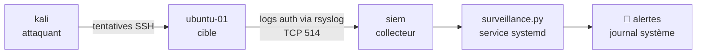

# 🛡️ mini-SIEM : détection d'attaques par force brute SSH

Projet personnel de cybersécurité : un **mini-SIEM** écrit en Python, qui analyse **en temps réel** des logs SSH centralisés et détecte les attaques par force brute, ainsi que les **compromissions** (brute force suivi d'une connexion réussie). Il tourne dans un **home lab** monté de zéro, où je joue à la fois l'attaquant (Kali Linux) et le défenseur (collecte et analyse des logs).

> Objectif : comprendre de l'intérieur comment fonctionne un SIEM : collecte, parsing, règles de détection, gestion des faux positifs.

---

## 🏗️ Architecture du lab

Le lab tourne sur un mini PC (Lenovo ThinkCentre M920q) sous **Proxmox VE**, avec trois machines virtuelles :

| VM | Rôle | Système |
|---|---|---|
| `kali` | Attaquant : génère les attaques | Kali Linux 2026.3 |
| `ubuntu-01` | Cible : serveur SSH durci | Ubuntu Server 26.04 LTS |
| `siem` | Collecteur : reçoit et analyse les logs | Ubuntu Server 26.04 LTS |



**Accès distant** : Tailscale, avec Proxmox en *subnet router*. Aucun port n'est ouvert sur la box Internet.

### Durcissement de la cible
- Authentification SSH **par clé uniquement** (`PasswordAuthentication no`)
- Connexion root interdite (`PermitRootLogin no`)
- Pare-feu `ufw` : seul SSH est exposé (vérifié par un scan `nmap` depuis Kali)

### Collecte des logs
`ubuntu-01` transfère ses logs d'authentification (`auth,authpriv.*`) vers `siem` avec **rsyslog** en TCP. La file d'attente garde les logs si le collecteur est indisponible. Côté `siem`, les logs sont rangés par machine et par programme :

```
/var/log/remote/<machine>/<programme>.log
```

Les fichiers sont créés en `0640` et les dossiers en `0750`, avec le groupe `adm` : seuls rsyslog et les membres de `adm` peuvent lire les logs.

---

## 📁 Contenu du dépôt

| Fichier | Rôle |
|---|---|
| `detect_bruteforce.py` | Parseur, règle de détection et **analyse ponctuelle** d'un fichier de logs |
| `surveillance.py` | **Surveillance en temps réel** : suit le fichier et alerte au fil de l'eau (brute force 🚨 et compromission 🔴) |
| `mini-siem.service` | Unité `systemd` pour faire tourner la surveillance en permanence sur `siem` |
| `sshd-session.log` | Logs d'exemple pour tester en local |

---

## ⚙️ Fonctionnement du détecteur

`detect_bruteforce.py` procède en trois étapes :

1. **Parsing** : chaque ligne est comparée à une liste de motifs d'échec (`MOTIFS_ECHEC`) et à un motif de connexion réussie (`MOTIF_SUCCES`). Si elle correspond, on extrait l'**IP source**, l'**utilisateur visé** et l'**horodatage** (ISO 8601).
2. **Agrégation** : pour chaque IP, on stocke le nombre d'échecs, les utilisateurs tentés et les heures d'échec.
3. **Détection** : pour chaque IP, on cherche le plus grand nombre d'échecs survenus dans une **fenêtre glissante** de `FENETRE` secondes. S'il atteint `SEUIL`, une alerte est levée.

### Événements détectés

| Événement OpenSSH | Exemple |
|---|---|
| Mot de passe refusé | `Failed password for remikaseya from 192.168.1.14 port 49376 ssh2` |
| Utilisateur inexistant | `Invalid user admin from 192.168.1.29 port 36864` |
| Utilisateur **existant** non authentifié | `Connection closed by authenticating user root 192.168.1.29 port 51234 [preauth]` |
| Connexion **réussie** | `Accepted publickey for remikaseya from 192.168.1.14 port 49400 ssh2` |

Le troisième cas est un **angle mort** découvert pendant les tests. Comme les mots de passe sont désactivés, une attaque sur un compte qui existe (`root`) ne produit ni `Invalid user` ni `Failed password` : elle passait inaperçue. C'est pourtant l'attaque la plus dangereuse.

### Pourquoi une fenêtre de temps ?

| Situation | Sans fenêtre | Avec fenêtre (3 échecs / 60 s) |
|---|---|---|
| 4 échecs en 7 secondes | ⚠️ Alerte | ⚠️ Alerte : **vrai positif** |
| 3 échecs étalés sur une journée | ⚠️ Alerte | ℹ️ Info : **faux positif évité** |

Un robot enchaîne les tentatives en quelques secondes ; un humain qui se trompe de mot de passe, non.

### Surveillance en temps réel

`surveillance.py` fonctionne comme un `tail -f` :

1. Il se place à la **fin** du fichier et attend les nouvelles lignes (générateur Python avec `yield`).
2. À chaque échec, il ajoute l'heure à la liste de l'IP, puis **oublie les échecs sortis de la fenêtre** (fenêtre glissante). La longueur de la liste donne directement le nombre d'échecs récents.
3. Si ce nombre atteint `SEUIL`, il lève une alerte, **une seule fois par fenêtre et par IP** : pendant une attaque de 100 tentatives, on reçoit une alerte par minute, pas 98.

```
🚨 [2026-11-22 17:25:12] ALERTE BRUTE FORCE : 192.168.1.29 a échoué 3 fois en moins de 60 s (dernier utilisateur visé : test)
```

Les heures sont en **UTC**, comme dans les logs : toutes les machines du lab partagent le même fuseau, ce qui facilite la corrélation des événements.

### Règle critique : compromission après brute force

Un brute force qui échoue est une tentative. Un brute force **suivi d'une connexion réussie** depuis la même IP signifie probablement que l'attaquant a trouvé un accès valide et **est entré** dans la machine.

À chaque connexion réussie (`Accepted`), `surveillance.py` regarde les échecs récents de l'IP. S'il y en a au moins `SEUIL` dans les `FENETRE` dernières secondes, il lève une **alerte critique** :

```
🔴 ALERTE CRITIQUE: 192.168.1.14 a réussi par bruteforce (publickey) à se connecter à remikaseya à 2026-11-22 17:58:42 après 3 échecs!
```

La **méthode** d'authentification fait partie de l'alerte, car elle oriente l'enquête : `password` après un brute force indique un mot de passe deviné ; `publickey` est plus inhabituel et peut signaler une clé volée.

La règle utilise le même seuil que le brute force : une simple faute de frappe avant une connexion légitime ne déclenche pas d'alerte critique.

### Correspondance MITRE ATT&CK

| Technique | Description |
|---|---|
| [T1110 – Brute Force](https://attack.mitre.org/techniques/T1110/) | Tentatives répétées d'authentification |
| [T1110.001 – Password Guessing](https://attack.mitre.org/techniques/T1110/001/) | Essais de mots de passe sur des comptes |
| [T1110.003 – Password Spraying](https://attack.mitre.org/techniques/T1110/003/) | Un même essai sur plusieurs comptes (`admin`, `root`, `test`…) |
| [T1078 – Valid Accounts](https://attack.mitre.org/techniques/T1078/) | Connexion avec un compte légitime après un brute force (alerte critique 🔴) |

---

## 🚀 Utilisation

### Configuration
En haut du script :

```python
SEUIL = 3       # nombre d'échecs déclenchant une alerte
FENETRE = 60    # durée de la fenêtre, en secondes
```

Le fichier à analyser est passé **en argument**. Sans argument, le script lit les logs de `ubuntu-01` sur `siem` (`/var/log/remote/ubuntu-01/sshd-session.log`).

### Analyse ponctuelle sur `siem` (bilan des vrais logs)
```bash
sudo python3 detect_bruteforce.py
```
`sudo` est nécessaire pour lire les logs.

### Test local avec le fichier d'exemple
```bash
python3 detect_bruteforce.py sshd-session.log
```

### Surveillance en temps réel (manuelle)
```bash
sudo python3 surveillance.py
```
Arrêt avec `Ctrl+C`.

### Déploiement en service `systemd`
La surveillance tourne en permanence sur `siem`, démarre avec la machine et redémarre seule en cas de plantage.

```bash
# Installation des scripts
sudo mkdir -p /opt/mini-siem
sudo cp detect_bruteforce.py surveillance.py /opt/mini-siem/

# Compte de service dédié : il peut seulement lire les logs (groupe adm)
sudo useradd --system --no-create-home --shell /usr/sbin/nologin --groups adm minisiem

# Activation du service
sudo cp mini-siem.service /etc/systemd/system/
sudo systemctl daemon-reload
sudo systemctl enable --now mini-siem

# Suivi des alertes
sudo journalctl -u mini-siem -f
```

Choix de sécurité :
- **Moindre privilège** : le service ne tourne pas en `root`, mais sous un compte système sans shell, membre du seul groupe `adm`.
- **Durcissement systemd** : `ProtectSystem=strict` (système en lecture seule), `ProtectHome=yes`, `PrivateTmp=yes`, `NoNewPrivileges=yes`. Même compromis, le service ne peut rien modifier.

### Exemple de sortie (analyse ponctuelle)
```
ℹ️  192.168.1.14 - 1 échec(s) - utilisateurs : remikaseya
⚠️  ALERTE : 192.168.1.20 a échoué 4 fois en moins de 60 secondes (brute force probable) - utilisateurs : admin, root, test, oracle
ℹ️  192.168.1.30 - 3 échec(s) - utilisateurs : remikaseya, remikaseya, remikaseya
⚠️  ALERTE : 192.168.1.40 a échoué 3 fois en moins de 60 secondes (brute force probable) - utilisateurs : root, root, root
```

### Reproduire une attaque (depuis Kali)
```bash
for u in admin root test oracle guest; do ssh -o BatchMode=yes $u@<IP_CIBLE>; done
```

### Simuler une compromission
Depuis une machine qui possède une clé autorisée sur la cible : quelques échecs, puis une connexion réussie depuis la même IP.
```bash
for u in admin test oracle; do ssh -o BatchMode=yes $u@<IP_CIBLE>; done
ssh <utilisateur>@<IP_CIBLE>
```
Résultat attendu dans `journalctl -u mini-siem -f` : une alerte 🚨 puis une alerte 🔴.
⚠️ À utiliser uniquement sur ses propres machines.

---

## 🚧 Limites connues

- **Double comptage possible** : si l'authentification par mot de passe est activée, OpenSSH peut écrire `Invalid user` **et** `Failed password` pour une même tentative.
- **Rotation des logs** : `surveillance.py` garde le fichier ouvert ; si le fichier est renommé ou recréé (logrotate), il faut redémarrer le service.
- **État en mémoire** : les échecs récents sont perdus au redémarrage du service.
- **Alertes locales** : les alertes ne sont visibles que dans le journal système (`journalctl`), sans notification.
- **Attribution derrière un NAT** : les connexions qui passent par Tailscale sont « masquées » par Proxmox (SNAT) et apparaissent avec l'IP `192.168.1.200`. Le SIEM ne voit alors pas l'IP réelle de la source, un problème classique derrière les VPN, proxys et load balancers.
- **Fenêtre de compromission courte** : un succès n'est relié qu'aux échecs des `FENETRE` dernières secondes ; un attaquant qui patiente avant de se connecter avec l'accès trouvé passerait inaperçu.
- **Une seule source** : un seul fichier de log est analysé à la fois (choisi en argument).
- **Liste des utilisateurs** : elle couvre tout l'historique de l'IP, pas uniquement la rafale qui a déclenché l'alerte.
- **Performance** : dans l'analyse ponctuelle, l'algorithme de fenêtre est en O(n²). C'est suffisant pour un lab ; la surveillance en temps réel, elle, utilise une fenêtre glissante bien plus légère.
- **Format de log** : le parseur attend des dates ISO 8601, telles qu'écrites par rsyslog.

---

## 🗺️ Feuille de route

- [x] Lab Proxmox : cible, attaquant et collecteur
- [x] Centralisation des logs avec rsyslog
- [x] Détection par seuil et fenêtre de temps
- [x] Détection des attaques sur des comptes existants
- [x] Détection d'une **intrusion réussie** (échecs puis `Accepted`)
- [x] Surveillance **en temps réel** + service `systemd` durci
- [ ] Nouvelles règles : échecs `sudo`, création d'utilisateur, scan de ports (logs `ufw`)
- [ ] Stockage des alertes (JSON / SQLite) et notifications
- [ ] Tableau de bord

---

## 🧠 Compétences mobilisées

- **Systèmes & réseau** : Proxmox VE, Linux (Ubuntu, Kali), SSH, `systemd`, droits Unix, adressage IP, DHCP, VPN (Tailscale)
- **Sécurité** : durcissement SSH, pare-feu `ufw`, reconnaissance `nmap`, centralisation de logs, ingénierie de détection, faux positifs, moindre privilège, MITRE ATT&CK
- **Développement** : Python (expressions régulières, `datetime`, structures de données, générateurs, modules), Git / GitHub
